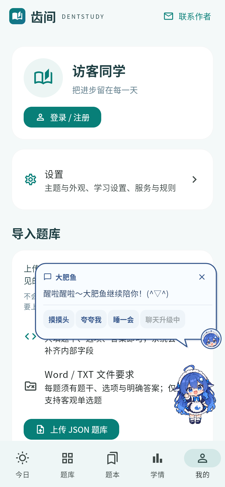
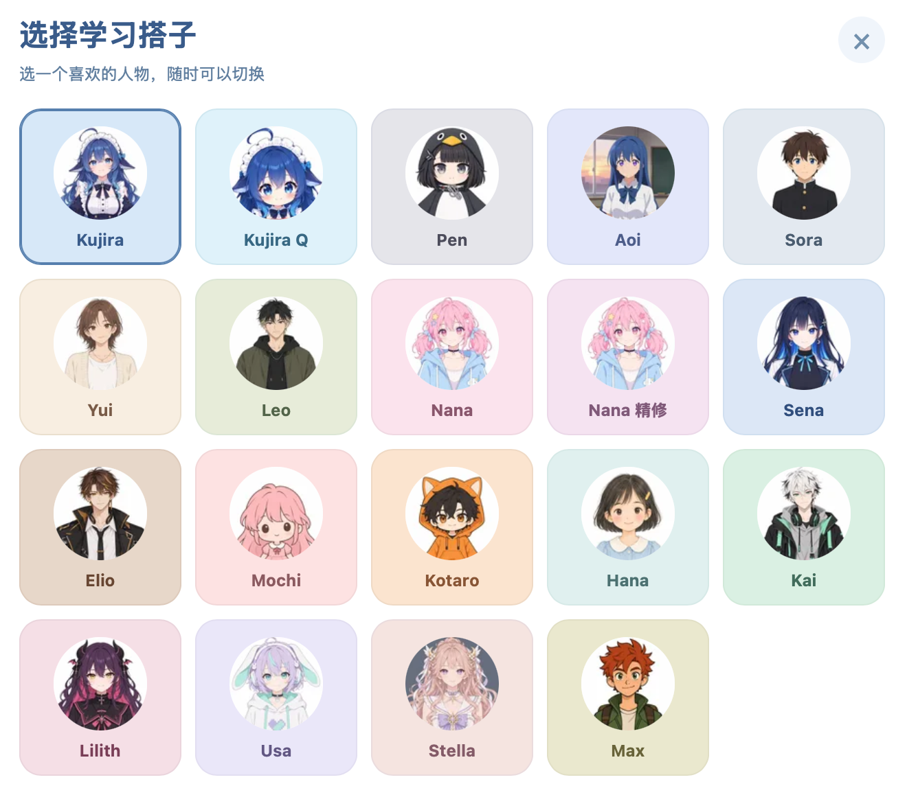
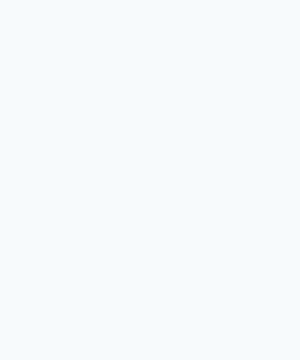

# 齿间 DentStudy

每天学一点，记牢一点。

## 这是什么？

**齿间 DentStudy** 是一个面向口腔医学学习者的中文学习工具，适合希望通过练习、记录和复习来整理知识的人。它把题目、错题和笔记放在一起，帮助你知道“今天可以学什么”“哪些内容需要再看看”。

无论你正在准备考研、执业考试，还是想巩固所学，都可以先从感兴趣的内容开始。**不同考试方向和学科的资料建设进度不同**；能否练习、题目是否已审核，请以网站内的实际标识为准。

👉 **[打开齿间 DentStudy](https://dentstudy.uno)**

### 第一次使用，可以这样开始

1. 打开网站，选择访客模式，或登录已有账号。
2. 进入“题库”，选择考试方向、学科和章节，找到想练习的内容。
3. 做题后查看答案和解析；遇到容易忘记或不理解的题，可以记录笔记、加入收藏或回到错题本复习。
4. 再次打开“今日”或“题本”，查看学习安排和之前记录的内容。

访客模式方便先体验；注册登录后，可在支持的功能中同步学习记录。**不是所有本机状态都会跨设备同步**，换设备前请留意网站提示。

### 它能帮我做什么？

| 你想做的事 | 齿间中的对应功能 |
| --- | --- |
| 按自己的进度练习 | 在题库中选择学科、章节和练习方式。 |
| 把做错的题找回来 | 错题会被归集，便于回看与再次练习。 |
| 记下自己的理解 | 给题目写笔记，或收藏想反复查看的内容。 |
| 安排复习 | “今日”页面提供学习与复习入口，具体安排以页面为准。 |
| 回顾学习情况 | 在“学情”中查看练习记录与统计。 |
| 使用自己的资料 | 根据页面说明导入符合格式且有权使用的题库；支持的格式和操作以网站显示为准。 |

### 复习安排

齿间提供复习安排和错题回看，帮助你重新检查已经学过的内容。建议结合教材、课程和自己的学习计划使用；学习效果因人而异。

### AI 和学习搭子是做什么的？

网站中有陪伴角色和与 AI 有关的探索。AI 可以辅助整理文字或生成回答，但**也可能理解错误或给出不准确的内容**。角色互动、AI 聊天或资料整理是否开放，以网站当时的提示为准；图片和动画预览也不等于这些功能均已上线。

学习医学知识时，请优先核对教材、课程及可靠资料。AI 生成内容不应替代专业审核，也不能作为医疗诊断或治疗建议。

### 题目、资料和隐私

- **题目来源不同**：资料整理题、模拟练习题、回忆版资料与正式试题不是同一种东西。请留意每份资料的来源、年份和审核状态；来源或年份无法确认时，不应把它当作确定事实。
- **医学内容需要校对**：尚未通过专业审核的题目或解析可能有误；发现疑问时，请结合可靠资料核实，并通过网站提供的方式反馈。
- **上传前确认使用权**：只导入或分享你有权使用的资料。避免上传他人的隐私、患者信息或其他不应公开的内容；页面会说明相关操作及可能的数据处理方式。
- **记录保存在哪里**：“本机”指当前使用的手机或电脑；“同步”指将支持同步的记录传到账号，供其他设备使用。具体范围取决于功能和登录状态。

## 产品预览

齿间 DentStudy 是面向口腔医学学习的中文学习工具，围绕题库练习、错题整理、复习安排与学习记录组织日常学习。线上入口：[dentstudy.uno](https://dentstudy.uno)。

### 进入齿间

访客可从入口进入学习；登录入口用于已有账号和跨设备同步。下图为线上入口截图（2026 年 11 月）。


### 学习节奏

学习计划与复习入口帮助安排每日学习；打卡日历用于回顾学习记录。下图为 2026 年 10 月的本地功能预览，界面和功能以线上实际版本为准。


### 备考搭子

大肥鱼为学习过程提供角色互动。下方动图由本地角色的三张姿态图制作，用于展示角色形象，**不是网站实际运行时动画录屏**；右侧图片为 2026 年 10 月的访客界面本地预览。AI 聊天的开放范围与当前可用性以网站实际提示为准。




### LivLiv 学习搭子预览

下图展示学习搭子选择界面；角色和功能以产品实际开放情况为准。



以下动图由本地 LivLiv Player 渲染录制，每幅使用 40 帧、约每秒 40 帧，按原始比例展示角色动作。它们是本地效果预览，不代表所有角色或交互目前均已对外开放。

| Kujira | Kujira Q | Pen |
| :---: | :---: | :---: |
|  |  |  |

| Kai | Elio | Mochi |
| :---: | :---: | :---: |
|  |  |  |

| Sena | Nana | Usa |
| :---: | :---: | :---: |
|  |  |  |

角色模型与播放器：[LivLiv](https://livliv.ai/)。Kujira 与 Kujira Q 的原角色溟月由[上善无形](https://www.bilibili.com/opus/1231977657712771073)创作，女仆设计由 [ZipZipPipe](https://www.bilibili.com/video/BV1tE9XBbErS/)创作；模型由 LivLiv 制作，原模型标注为 [CC BY-NC-SA 4.0](https://creativecommons.org/licenses/by-nc-sa/4.0/)。Pen 源自贱兔死顺盖创作的粉丝角色「咕咕嘎嘎」，模型由 LivLiv 制作；其来源和使用条款与 LivLiv 其他精选角色不同。角色授权和使用范围应以各权利人的许可为准。

> 学习资料与题目可能仍处于整理或审核阶段。题目来源、医学准确性及实际开放功能请以具体题目和网站内的提示为准。

## 给好奇的读者：网站是怎么工作的？

主要技术及其用途：

- **前端**是你看到和操作的页面。齿间使用 Flutter（一套制作应用界面的工具）开发客户端。
- **后端**负责处理账号以及支持同步的学习记录等请求。项目中的后端使用 Python 编写。
- **数据库**用于有序存储和读取数据；本项目使用 SQLite，一种适合轻量场景的数据库。
- **API（应用程序接口）**规定前端和后端如何请求和交换数据。
- **服务器**是运行网站或保存服务数据的计算机；**HTTPS**是浏览器与网站之间加密通信的方式。它们有助于提供服务，但不能代替完整的安全管理。
- **Git 和 GitHub**分别用于记录代码变化和托管代码。把代码推送到 GitHub，并不自动意味着网站已经更新。

对学习者来说，不需要安装上述工具，直接访问网站即可；希望自己运行或参与开发的读者，可以展开下方资料。

<details>
<summary><strong>开发者资料与历史版本说明（点击展开）</strong></summary>

以下保留仓库原有的技术说明和阶段记录，部分题量、功能开放、部署及支付状态可能已过时，不代表当前线上状态；具体请以网站实际页面、代码和最新部署文档为准。命令面向有开发经验的读者，运行或部署前请先阅读对应文档。

## 章节归并与未读提醒（2026-10-24）

`scripts/merge_legacy_subject_chapters.py` 为既有1000题资料中的解剖123题、修复100题添加经逐项检查的 `chapterByMode.执医` 目录归属。解剖归入“一、牙体解剖”；修复分别归入临床接诊15题、固定义齿28题、可摘局部义齿56题、全口义齿1题。沿用现有章节，不保留单独的同名学科目录卡片；原资料入口、题目ID、来源原章节、题干、选项、答案、解析、学习方向及题目顺序均不变。完整题库仍为21,327题；来源JSON和分科JSON同步添加目录字段，原文件保存在 `question-bank/backups/subject-chapter-merge-20261024/`。旧下载缓存只叠加内置目录字段，不清空学习记录或个人导入题库。

个人页消息入口和底部“我的”共用 `StudyStore.socialUnreadCount`，私信按对话未读数统计、通知按服务端未读总数统计，避免把私信通知重复计算。前台每10秒检查一次，恢复前台/切换账号会刷新；后台暂停检查。只打开“我的”或消息列表不会把未看的内容当作已读，实际打开对话、查看通知后同步消除相应红点；仍有其他未读则继续提醒。失败保留已确认的未读状态，读后过期请求不能重新点亮，退出或换号不显示前一账号的提醒。此功能是应用内红点，不是浏览器/系统推送。

## 考研院校资料（2026-10-24）

题库 → 考研 → 按学校分类，提供大连医科大学、温州医科大学，各自分为“历年真题（回忆版）”与按科目合并的“资料包”。这部分是独立的资料阅读资产 `mobile/assets/school_library.json`，不改变可判分题库、题目ID或作答历史。

温医大扫描件在本机识别并脱敏，仅发布学习文字；封面、前言、署名、个人信息、原PDF、页面图片及私有文件路径不发布。466条回忆题记录中，461条按题目旁原标年份归档（2007—2026，区分复试），5条年份识别有冲突，保留在待核对资料中；更新版次不能替代考试年份。参考内容合并成10个科目资料包，保留扫描符号提示，主观题不自动判分。

答案更新：按用户确认正确的原资料收录答案，并提高扫描识别分辨率重新整理。253条题目已配对答案，其余213条暂不强行配对，可进入各科资料包按关键词搜索。温医大历年真题来源保持“真题”，资料包中科目讲义的来源按用户指定为“人卫讲义”；暂存资料包的年份待核对真题仍保留真题来源。阅读页、合并阅读、来源详情与正文提示一致，讲义不标成真题。取消PDF来源/页码、“原资料标注”和“【原资料答案】”等展示；每道题及其答案合为一个连续段落，题间空行。原始定位仅用于内部校对，不删除用户原文件，不伪造5条尚未确定的年份，主观题仍不自动判分。

文字校对：`scripts/wenzhou_proofread.py` 仅处理温医大识别稿，按口腔术语上下文恢复被误识别的“𬌗”，并对照扫描原页修正颊/舌侧、卡环臂、缺隙、牙髓/牙龈等及局部错行漏字；题目、配对答案、资料包由同一流程生成。规则保留正常的颌骨、咬合、高频/频率、踝部等词，不将整份扫描件宣称为已逐字无误。保留466条题目ID、年份和此前252项答案关联；额外恢复1项因“盖髓”误识别而缺失的明确原文匹配。原始OCR不改写、不发布；校对操作数写入内部整理报告。

学校页按需加载：先读取约139KB的 `school_library_index.json` 元数据目录，不再为学校列表加载约8.9MB的完整资料；点开某份阅读资料才请求对应正文，主动全文搜索才加载该校正文。正文以内容哈希命名、缓存并去重请求，最多两个并发；目录和正文请求均有超时、失败重试，不清理用户数据。`scripts/package_school_library.py` 生成目录及正文分片，两校打包脚本在重建后自动同步生成。

`scripts/ocr_school_pdf.swift` 与 `scripts/ocr_school_exam_rows.swift` 只在本机运行，原始识别结果须存放在仓库和公开目录之外。`scripts/build_wenzhou_school_assets.py` 使用题目行定位年份、去除个人信息并在输出前检查隐私；来源文件改变时拒绝沿用旧页码映射。两所学校的单独重建均保留其他院校资料。

## 这是什么？

**齿间 DentStudy** 是一个面向口腔医学学习者的中文学习工具，适合希望通过练习、记录和复习来整理知识的人。它把题目、错题和笔记放在一起，帮助你知道“今天可以学什么”“哪些内容需要再看看”。

无论你正在准备考研、执业考试，还是想巩固所学，都可以先从感兴趣的内容开始。**不同考试方向和学科的资料建设进度不同**；能否练习、题目是否已审核，请以网站内的实际标识为准。

👉 **[打开齿间 DentStudy](https://dentstudy.uno)**

### 第一次使用，可以这样开始

1. 打开网站，选择访客模式，或登录已有账号。
2. 进入“题库”，选择考试方向、学科和章节，找到想练习的内容。
3. 做题后查看答案和解析；遇到容易忘记或不理解的题，可以记录笔记、加入收藏或回到错题本复习。
4. 再次打开“今日”或“题本”，查看学习安排和之前记录的内容。

访客模式方便先体验；注册登录后，可在支持的功能中同步学习记录。**不是所有本机状态都会跨设备同步**，换设备前请留意网站提示。

### 它能帮我做什么？

| 你想做的事 | 齿间中的对应功能 |
| --- | --- |
| 按自己的进度练习 | 在题库中选择学科、章节和练习方式。 |
| 把做错的题找回来 | 错题会被归集，便于回看与再次练习。 |
| 记下自己的理解 | 给题目写笔记，或收藏想反复查看的内容。 |
| 安排复习 | “今日”页面提供学习与复习入口，具体安排以页面为准。 |
| 回顾学习情况 | 在“学情”中查看练习记录与统计。 |
| 使用自己的资料 | 根据页面说明导入符合格式且有权使用的题库；支持的格式和操作以网站显示为准。 |

### 复习安排

齿间提供复习安排和错题回看，帮助你重新检查已经学过的内容。建议结合教材、课程和自己的学习计划使用；学习效果因人而异。

### AI 和学习搭子是做什么的？

网站中有陪伴角色和与 AI 有关的探索。AI 可以辅助整理文字或生成回答，但**也可能理解错误或给出不准确的内容**。角色互动、AI 聊天或资料整理是否开放，以网站当时的提示为准；图片和动画预览也不等于这些功能均已上线。

学习医学知识时，请优先核对教材、课程及可靠资料。AI 生成内容不应替代专业审核，也不能作为医疗诊断或治疗建议。

### 题目、资料和隐私

- **题目来源不同**：资料整理题、模拟练习题、回忆版资料与正式试题不是同一种东西。请留意每份资料的来源、年份和审核状态；来源或年份无法确认时，不应把它当作确定事实。
- **医学内容需要校对**：尚未通过专业审核的题目或解析可能有误；发现疑问时，请结合可靠资料核实，并通过网站提供的方式反馈。
- **上传前确认使用权**：只导入或分享你有权使用的资料。避免上传他人的隐私、患者信息或其他不应公开的内容；页面会说明相关操作及可能的数据处理方式。
- **记录保存在哪里**：“本机”指当前使用的手机或电脑；“同步”指将支持同步的记录传到账号，供其他设备使用。具体范围取决于功能和登录状态。

## 产品预览

齿间 DentStudy 是面向口腔医学学习的中文学习工具，围绕题库练习、错题整理、复习安排与学习记录组织日常学习。线上入口：[dentstudy.uno](https://dentstudy.uno)。

### 进入齿间

访客可从入口进入学习；登录入口用于已有账号和跨设备同步。下图为线上入口截图（2026 年 11 月）。


### 学习节奏

学习计划与复习入口帮助安排每日学习；打卡日历用于回顾学习记录。下图为 2026 年 10 月的本地功能预览，界面和功能以线上实际版本为准。


### 备考搭子

大肥鱼为学习过程提供角色互动。下方动图由本地角色的三张姿态图制作，用于展示角色形象，**不是网站实际运行时动画录屏**；右侧图片为 2026 年 10 月的访客界面本地预览。AI 聊天的开放范围与当前可用性以网站实际提示为准。


### LivLiv 学习搭子预览

下图展示学习搭子选择界面；角色和功能以产品实际开放情况为准。


以下动图由本地 LivLiv Player 渲染录制，每幅使用 40 帧、约每秒 40 帧，按原始比例展示角色动作。它们是本地效果预览，不代表所有角色或交互目前均已对外开放。

| Kujira | Kujira Q | Pen |
| :---: | :---: | :---: |
|  |  |  |

| Kai | Elio | Mochi |
| :---: | :---: | :---: |
|  |  |  |

| Sena | Nana | Usa |
| :---: | :---: | :---: |
|  |  |  |

角色模型与播放器：[LivLiv](https://livliv.ai/)。Kujira 与 Kujira Q 的原角色溟月由[上善无形](https://www.bilibili.com/opus/1231977657712771073)创作，女仆设计由 [ZipZipPipe](https://www.bilibili.com/video/BV1tE9XBbErS/)创作；模型由 LivLiv 制作，原模型标注为 [CC BY-NC-SA 4.0](https://creativecommons.org/licenses/by-nc-sa/4.0/)。Pen 源自贱兔死顺盖创作的粉丝角色「咕咕嘎嘎」，模型由 LivLiv 制作；其来源和使用条款与 LivLiv 其他精选角色不同。角色授权和使用范围应以各权利人的许可为准。

> 学习资料与题目可能仍处于整理或审核阶段。题目来源、医学准确性及实际开放功能请以具体题目和网站内的提示为准。

## 给好奇的读者：网站是怎么工作的？

主要技术及其用途：

- **前端**是你看到和操作的页面。齿间使用 Flutter（一套制作应用界面的工具）开发客户端。
- **后端**负责处理账号以及支持同步的学习记录等请求。项目中的后端使用 Python 编写。
- **数据库**用于有序存储和读取数据；本项目使用 SQLite，一种适合轻量场景的数据库。
- **API（应用程序接口）**规定前端和后端如何请求和交换数据。
- **服务器**是运行网站或保存服务数据的计算机；**HTTPS**是浏览器与网站之间加密通信的方式。它们有助于提供服务，但不能代替完整的安全管理。
- **Git 和 GitHub**分别用于记录代码变化和托管代码。把代码推送到 GitHub，并不自动意味着网站已经更新。

对学习者来说，不需要安装上述工具，直接访问网站即可；希望自己运行或参与开发的读者，可以展开下方资料。

## 当前题库与统计口径

- 默认客户端与后端读取 `mobile/assets/all_questions.json`；当前内置 **4,210 道考研方向题目**：口腔颌面外科学 2,110 道、14 章；口腔修复学 2,100 道、8 章。
- 其中口外为 2,094 道基于用户提供讲义的资料整理单选题与 16 道来源待核验的回忆题/简答题；修复为 1,574 道资料整理题、525 道模拟练习题与 1 道来源待核验回忆题。所有题目均显示为“待审核”，不应宣传为已审核真题库。
- 题库页按“口腔颌面外科学 / 口腔修复学 → 章节”展开；本科期末、执医方向当前会如实显示“题库建设中”。用户仍可在“我的”导入自己拥有使用权的 JSON、Word 或 TXT 资料，并仅在本地练习。
- 从旧版升级时会清理已下架的公开题库缓存。私有题库仍按账号保存在本机，升级会保留学习记录、待同步事件和练习断点。
- Git 历史中的旧提交不在本次修改范围内；若需处理已公开的历史提交或线上部署版本，请另行执行相应的仓库与服务器操作。

## 学习闭环与本机记录

今日计划默认安排 20 道新题；到期复习和昨日题目复习作为独立入口，均不会锁住新题学习。每日计划默认逐题深度模式；自定义练习可选学科、章节、10/20/50/100 题、随机与三种模式。

学习进度按不同题目统计；正确率按客观题作答次数统计；主观题不自动计入正确率。疑问题复用最近掌握度 `guessed`。学习用时仅从新版开始按本机会话记录，后台暂停，旧记录无耗时不补算；预计时间按每题 1.5 分钟估算。

答案、评级、进度、原模考截止时间和已提交题目保存为账号隔离的本机断点；本机会话元数据与用时暂不跨设备同步。答题、收藏、笔记、移出错题仍使用原事件与同步协议；排期仍由原 reducer 计算。

## 已写入的功能

- 首页待复习任务、跨考试模式的旧题优先与新题解锁。
- 1、2、4、7、14 天复习阶梯；做错重置、蒙对回退、掌握晋级；同日/提前重做不晋级。
- 考研 / 本科期末 / 执医切换；章节、科目、考点关键词、院校、年份、题型、标签筛选。
- 普通练习、随机练习、收藏练习、限时套卷；客观题自动计分，主观题参考要点自评。
- A1/A2/A3/A4/B、简答、案例题数据模型与共用题干。
- 错题自动归集、手动移除；收藏；题目笔记；近 7 天练习量、周统计与薄弱章节建议。
- 本机离线答题、题库下载；注册/登录、跨设备事件同步、重试去重与账号数据隔离。
- 用户可在“我的”选择符合模板的 JSON 题库，本地导入后立即练习；登录用户可将原文件投稿到作者私有审核箱。投稿文件不公开，上传前须确认拥有分享权限。
- Word/TXT 导入同时提供本地格式整理与 AI 智能整理：AI 仅在用户点击后把本次文字发送至阿里云百炼，服务端不保存原文；只提取原文已有的题干、选项和明确答案，不补题、不猜答案。每账号每天最多 3 次、单次最多 6 万字，整理结果仍是待医学审核的本地导入题库。
- “小齿”是右下角可拖动的口腔备考搭子，使用原始插画，带待机、互动、思考、说话、感谢五种状态动画；可在“我的 → 学习设置”关闭。它已熟悉“今日、题库、题本、学情、我的”、三种练习模式、题库搜索与导入的只读使用路径，可解释“该去哪里、该点什么”，但不能代替点击、跳转、上传或下载。当前聊天功能仍仅向配置的作者账号开放，其余用户点击会看到“小齿正在升级中···”。聊天临时会话不保存聊天内容，不会协助侵权资料；服务端只保存作者账号标识、调用类别及额度计数。
- 题库关键词搜索：题干、选项、解析、考点与题目编号；支持学科/章节范围、多关键词和不区分英文大小写，“咬合”可搜到“𬌗”。
- 章节解析连续浏览、章末下一章入口；错题/收藏/搜索结果内连续切题。解析阅读位置按账号和方向保存在本机，不产生作答事件。
- 本地精简中文字体覆盖当前题库与界面字符，包含“𬌗”；主题与版本更新时间可在“我的”查看。
- 本地通知排期代码：北京时间 20:00，最多预排未来 14 天；仍需真机验证权限、重启和系统省电行为。
- 题库校验与导入命令，包含正式内容审核字段、教材出处字段与不可变题目 ID。

## 仍需要的外部条件与后续开发

- 正式题库：当前资料整理题和演示题均未通过正式内容审核；真实审核状态必须以题目字段为准。
- 原生工程：本机已有 Android/iOS 包装工程；缺失时可使用下面的 bootstrap 命令生成。本轮未进行原生编译、签名或真机验收。应用标识暂为 `com.example.dentstudy`。
- 服务部署：网站与同源 API 已部署至 https://dentstudy.uno，使用阿里云 ECS、Nginx 和 HTTPS；当前手动发布，推送 GitHub 不会自动更新网站。支付宝网页应用已显示“已上线”，电脑网站支付产品已签约生效，但生产服务器尚未加载支付环境文件，支付宝和微信的独立 LIVE 开关均关闭，因此真实收款仍关闭。应用私钥与应用公钥已核验为同一对；仍须通过支付宝自身安全验证取得官方支付宝平台公钥、绑定不可变的支付作者账号 ID，并完成沙箱/受控订单的回调、查单、对账和退款验收后才能开放。套餐、条款和付款入口只对服务器绑定的支付作者可见，详见 `docs/PAYMENT_SETUP.md`。邮件验证码也尚未开通。
- 远程推送：本地通知已写入，APNs/FCM/国内厂商通道、设备令牌、服务端推送任务尚未接入。
- 题库后台：本次提供 CLI 导入与审核校验，不含多人协作的图形化 CMS。
- 正式考务：未实现防作弊、服务端权威计时、主观题人工批改与跨设备统一的考试中断恢复；本机可保留作答和原截止时间，模考仍属于学习练习功能。
- 大规模题库：当前用完整事件同步与 SharedPreferences，适合 MVP；正式规模需分页增量同步、本地 SQLite 与服务端 PostgreSQL。

## 启动后端

依赖 Python 3.10+，无第三方运行时依赖。

```bash
cd backend
python3 server.py
```

默认只监听 `127.0.0.1:8787`，首次启动生成本地 SQLite 数据库。Android 模拟器通过 `http://10.0.2.2:8787` 访问；iOS 模拟器使用 `http://localhost:8787`。真机调试需在受信网络运行 `python3 server.py --host 0.0.0.0`，APP 中填写电脑的局域网地址；iOS 真机建议使用受信任的 HTTPS 开发地址。

```bash
cd backend
python3 -m unittest discover -s tests -v
```

## 生成并运行 Flutter 客户端

先准备 Flutter 3.35+、Android SDK/JDK 17。iOS 另需 macOS、Xcode 与 CocoaPods。参考 [Flutter 安装](https://docs.flutter.dev/install)、[iOS 环境配置](https://docs.flutter.dev/platform-integration/ios/setup)。

```bash
cd mobile
bash bootstrap.sh
dart format lib test
flutter analyze
flutter test
flutter run --dart-define=API_URL=http://10.0.2.2:8787
```

`bootstrap.sh` 会保留 `lib/`、`test/`、`pubspec.yaml`，生成平台项目并设置通知权限和调试网络。若 `python3` 不是可用解释器，可用 `PYTHON_BIN=/path/to/python3 bash bootstrap.sh`。

模拟器或设备必须实际启动并被 `flutter devices` 检出。当前 API 地址可在“我的 → 配置后端地址”修改；登录后换服务器前需先退出账号。首次答题可完全离线，登录不是先决条件。

```bash
# Android 调试安装包（尚未在本环境执行）
flutter build apk --debug
# Android 发行包：先配置自己的应用 ID、签名与 HTTPS API
flutter build appbundle --release --dart-define=API_URL=https://your-api.example.com
# iOS：需开发者签名与配置好的 Xcode
flutter build ipa --release --dart-define=API_URL=https://your-api.example.com
```

Git 远程仓库为 `stein-wang0226/dentstudy-mvp`。`.github/workflows/check.yml` 定义后端检查、Flutter 分析/测试以及 Android 调试包构建；当前本地改版不代表已推送或远程 CI 已通过。

## 演示验收路径

1. 打开“今日”，初始无历史记录，因此新题开放。
2. 开始学习新题，选择答案，点击查看解析，再标记“做错 / 蒙对 / 完全掌握”。答错时只能标记做错。
3. 返回首页或打开“题本”，检查错题/收藏；进入解析页保存笔记。
4. 次日北京时间 00:00 后，首页出现到期题；未完成时不能从其他学习模式绕过门槛练新题。
5. 在“我的”注册并同步。访客记录保留在独立空间，按“导入本机访客记录”才合并到该账号。
6. 第二台设备使用相同 API 与账号登录，验证笔记、收藏、答题记录和排期。
7. 开启复习提醒后，用真机验证通知授权、进入后台、设备重启和当天完成后的重排。

## 导入题库

```bash
python3 backend/bank.py validate mobile/assets/all_questions.json
# 正式库必须通过完整审核字段校验；演示库会被此模式拒绝
python3 backend/bank.py validate /path/to/reviewed-bank.json --production
python3 backend/bank.py import /path/to/reviewed-bank.json --production
```

导入采用追加合并；不能用同一个题目 ID 改写历史内容。修订答案/题干时分配新版本 ID。正式发布前应新建不含演示题的发布库或使用 `--output /path/to/new-bank.json` 输出独立题库，再配置服务端 `DENTSTUDY_BANK` 路径。不要删除已有用户历史所引用的题目。

Word/TXT 的“AI 智能整理”不是医学审校或题目生成器：它会先要求题库名称、科目、章节和学习方向，再仅结构化用户明确提供答案的客观题。原文字仅在本次请求中交给阿里云百炼，不写入 DentStudy 数据库或日志；请勿上传隐私、受限或无权使用的资料。服务端默认使用 `qwen3.7-flash` 非思考模式，并设置每账号每日 3 次、每月 ¥20 等值的服务器总预算保护；免费试用额度耗尽或预算到顶时会停止服务而非继续扣费。

数据结构和接口见 [docs/API.md](docs/API.md)，排期细节见 [docs/SCHEDULER.md](docs/SCHEDULER.md)，上线差距见 [docs/DEPLOYMENT.md](docs/DEPLOYMENT.md)。

</details>
